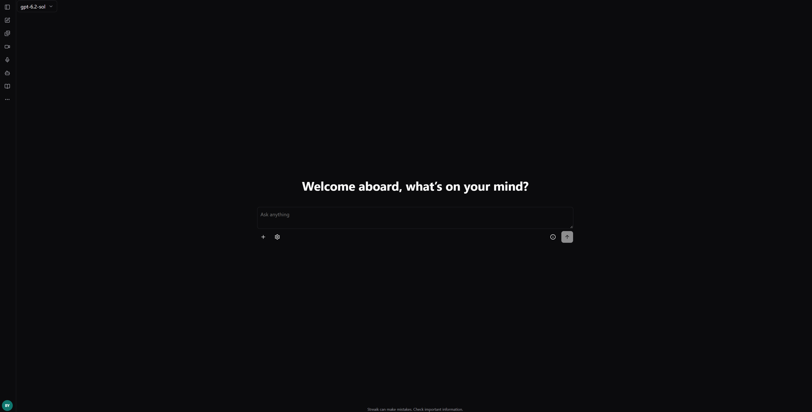

# streaik-web

A browser-based AI chat client with streaming, provider switching, Agents, [MCP](https://modelcontextprotocol.io/), [Skills](https://agentskills.io), [Plugins](https://agent-plugins.org), files and rich response rendering.

Connect compatible AI APIs, agent runtimes and MCP servers directly from the client.

The chat client supports:

- **Streaming chat** with rich incremental message rendering, charts and more
- **Provider and model switching** across Gateway and direct provider APIs
- **Multi-protocol routing** through API Chat, Responses, Messages, Chat Completions and Direct APIs
- **Model discovery** with catalogs, favorites, filters and configurable default preferences
- **Provider settings** with model-specific options and native metadata passthrough
- **Agents and workflows** on direct APIs or through connected agent runtimes with multi-agent orchestration
- **Realtime agents** with bidirectional audio, interruptions, streaming playback and tool execution
- **Decisions** with intelligent multi-model and agent routing based on user input and configurable decision models
- **Agent Plugins** combining Skills, MCP servers and supporting resources
- **MCP** tools, resources, prompts, elicitation and tasks. Prompt and resource template arguments stay free-form and offer suggestions when the server advertises completions.
- **Tool execution** with parallel tool calls, human-in-the-loop approvals and execution activity
- **Server-side tools** with provider-native web search, code execution, MCP and other supported capabilities
- **Skills** with reusable instructions and supporting files
- **Search** with client-side full-text, vector and hybrid search
- **Files** with attachments, document content, PDF extraction and rich file handling
- **Conversation history** with local persistence, configurable chat preferences, and browser-only full-text search across titles and user and assistant messages
- **Streaming UI** with interactive apps, cards and structured response rendering
- **Speech** with generation, streaming playback and realtime transcription
- **Transcriptions** with configurable file splitting, overlap handling and merged results. **Real-time** streams microphone audio to supported OpenAI, Gladia, Google Gemini Transcribe Live, Deepgram Nova-2/Nova-3, and AssemblyAI streaming models and displays text only. A compatible live model assigned to the Transcription agent can also stream composer dictation. **Dictate** on the Transcriptions page records a short clip and uploads it when you stop.
- **Images** with generation and provider-specific options
- **Videos** with prompt-only generation and inline playback. Pending jobs and results are saved locally for the current gateway/profile. Reopen Videos with the same credentials to resume polling; gateway job references and provider-hosted video links can expire.
- **Benchmarks** with multi-model comparisons, configurable routing and repeatable test runs
- **Usage analytics** with interactive charts, token consumption and cost tracking
- **Performance metrics** including time to first token (TTFT) and tokens per second (TPS)
- **Authentication** with header-based/BYOK and Microsoft Entra support
- **Multi-theme UI** with interchangeable Shadcn, Fluent and HTML implementations
- **Localization** with support for 2+ languages
- **Model capabilities** including speech, transcription, embeddings, reranking, images, video, decision and other supported modalities

Deepgram and AssemblyAI microphone sessions use temporary credentials from the gateway; audio goes directly from the browser to the selected provider. AssemblyAI connects to its default US host (`streaming.assemblyai.com`). Use `assemblyai/assemblyai-stt-3-7-realtime` for new deployments; the Universal Streaming English and Multilingual IDs are retained for compatibility where the provider still accepts them. Live transcription does not play a spoken response.

Documentation: https://ai.streaik.net/scalar  
App: https://chat.streaik.com

## Local mode

Use [local.streaik.com](https://local.streaik.com) with the standalone Windows runtimes:

- [streaik-gateway](https://github.com/Streaik/streaik-gateway/releases/latest)
- [streaik-agents](https://github.com/Streaik/streaik-agents)

The browser app connects to AI and Agents running on your own PC.

## Windows desktop

A standalone, Windows 11 native application built with WinUI 3. The AI gateway and Agents runtime runs on your own machine.

- Streaming chat with model and agent switching
- MCP tools and resources, Skills and local conversation history
- Native Windows UI with light, dark and high-contrast themes
- Local and remote runtime switching

**Repository:** [streaik-windows](https://github.com/Streaik/streaik-windows)

